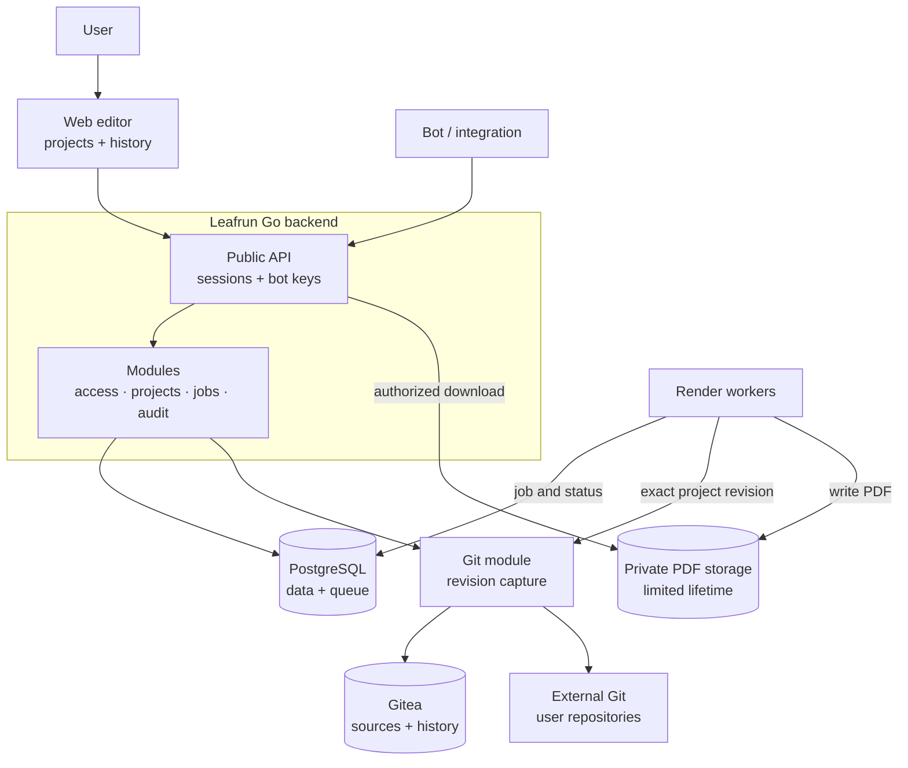
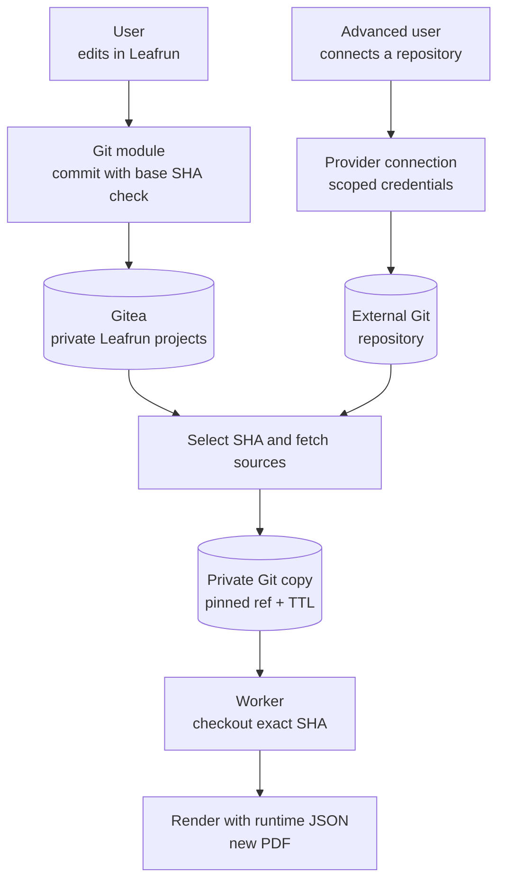
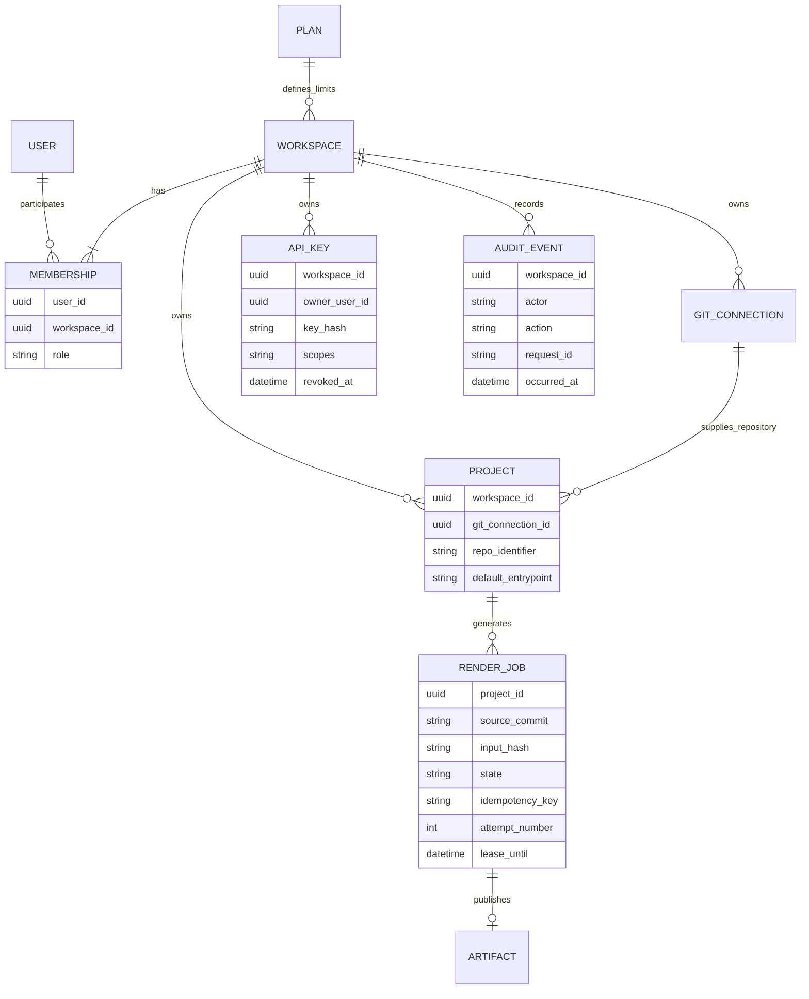
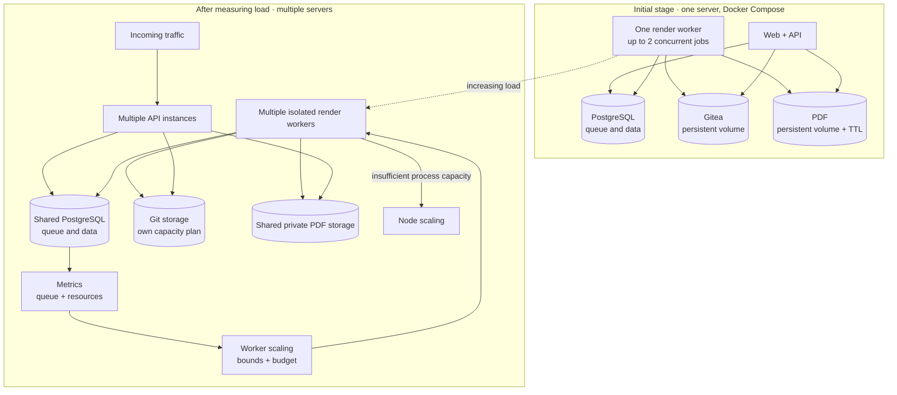

# Leafrun: document generation SaaS

> Historical design, retained from the upstream repository. Superseded by the [current Leafrun architecture](https://github.com/leafrun/leafrun/blob/main/docs/architecture.md) and [roadmap](https://github.com/leafrun/leafrun/blob/main/docs/roadmap.md). Historical implementation claims refer to commit `d77d9a9`, not this checkout, which contains only the local rendering function.

Discussion draft v0, October 6, 2026. The SaaS services described below were proposed for the next stage and had not been implemented. On October 7, five diagrams and a discussion area were transferred to the [Miro board](https://miro.com/app/board/uXjVEd6scg8=/).

The original proposal starts with one Go application, a separate rendering process, PostgreSQL and hosted Gitea. People use the web interface; bots use the API. Git stores sources and history; the application database stores the queue, access, plans and audit. Add servers after measuring load.

Diagrams are editable in this Markdown. Standalone Mermaid and SVG files live in [diagrams/](diagrams/); `.mmd` files also open in [Mermaid Live Editor](https://mermaid.live/).

## Historical implementation and proposed additions

| Component | Status in the earlier server revision |
|---|---|
| Git → isolated working directory → Typst → PDF | Implemented |
| Synchronous `POST /api/render`, Bearer key, source SHA, limits and cleanup | Implemented |
| Git cache, public external repositories and private Gitea | Implemented |
| Docker Compose with the renderer and hosted Gitea | Implemented and checked |
| Accounts, workspaces, roles and individual bot keys | Planned |
| Web editor, templates and project management | Planned |
| Queue, PDF storage, render history, plans and audit | Planned |
| Collaboration and automatic scaling | Later stages |

Typst uses its own `.typ` markup. The proposed Markdown path is Markdown → Typst content → PDF. [cmarker](https://typst.app/universe/package/cmarker/) is a candidate whose compatibility and required Markdown features need verification. Ordinary Markdown should disable arbitrary Typst insertion with `raw-typst: false`; mathematics and extensions need separate decisions. See [Typst syntax](https://typst.app/docs/reference/syntax/).

## 1. Overall architecture

Except for the earlier renderer and Gitea, these blocks represent planned development. Application blocks are modules of one Go backend, not independent services.



The Git module initially belongs to the backend and source-preparation process. It hides provider differences and checks each connection's permissions. A renderer receives only its job's sources, not a shared collection of user tokens.

PostgreSQL stores jobs with application state. Multiple workers can claim jobs using [`FOR UPDATE SKIP LOCKED`](https://www.postgresql.org/docs/current/sql-select.html). Redis was optional in this initial design.

## 2. Request to PDF

Long rendering work moves out of the HTTP request. The proposed public API is:

| Request | Result |
|---|---|
| `POST /v1/projects/{project_id}/renders` | `202`, render ID, state and selected SHA |
| `GET /v1/renders/{render_id}` | State, SHA and bounded diagnostics |
| `GET /v1/renders/{render_id}/pdf` | Authorized PDF download before expiry |
| `POST /v1/renders/{render_id}/cancel` | Cancel queued or active work |

The request contains `ref`, `entrypoint` and `data`; the project supplies the repository address. An `Idempotency-Key` returns the previously created job in the same workspace. Reusing it with different content returns `409`. Runtime JSON is not committed to Git.

Persist bounded JSON as private job input for queuing and retries. Only that job's execution process receives it. Delete it after termination and the retry window; retain its hash in the manifest and audit.

```mermaid
sequenceDiagram
    actor Client as User or bot
    participant API as Leafrun API
    participant Git as Git module
    participant DB as PostgreSQL
    participant Worker as Render worker
    participant Typst as Typst CLI
    participant Files as PDF storage

    Client->>API: Create project render + Idempotency-Key
    API->>DB: Check access and existing job by key
    API->>Git: Resolve requested ref to an exact SHA
    Git-->>API: Selected commit SHA
    API->>DB: Atomically check quotas, reserve capacity and create queued job
    Note over API,DB: Recheck key inside the transaction; call Git outside it
    API-->>Client: 202 + render_id + source_commit

    Worker->>DB: Claim job with lease and attempt number
    Worker->>Git: Prepare and pin selected SHA
    alt Selected revision unavailable
        Git-->>Worker: source_revision_unavailable
        Worker->>DB: failed + audit event
    else Sources ready
        Git-->>Worker: Pinned project revision
        Worker->>Typst: Isolated working directory + JSON + limits
        Typst-->>Worker: PDF or error
        alt Compilation succeeded
            Worker->>Files: Store successful attempt PDF
            Worker->>DB: Check lease, publish result and audit
        else Compilation failed
            Worker->>DB: failed + bounded diagnostics + audit
        end
    end
    Client->>API: Check status and download result
    API->>DB: Check access and retention
    API->>Files: Read available PDF
    API-->>Client: PDF or status/error
```

States are `queued → preparing → rendering → publishing → succeeded`, with `failed`, `canceled` and `expired` alternatives. A Typst error skips publication, stores bounded diagnostics and terminates the job.

Heartbeats renew the job lease. A crashed job may execute again; attempt numbers prevent an expired worker from publishing. Periodic cleanup removes temporary files, unreferenced PDFs and pinned revisions. Retry transient infrastructure errors only, with a bounded count; markup errors are not automatically retried.

Record source SHA, entry point, JSON hash, input format, Typst and adapter versions in the render manifest. Reproducibility additionally requires pinned packages, fonts and environment. Execution timeout is separate from queue wait.

## 3. Git project storage



For ordinary users, creating a project creates a private Gitea repository; saving creates a commit. A base-SHA check returns a conflict if another user has changed the document, preventing silent overwrite. Gitea stores history; Leafrun checks SaaS accounts and authorization.

External connections initially support reading and rendering. OAuth/PAT writes, webhooks and automatic builds are separate additions. Encrypt tokens and scope them to provider and workspace; do not put them in URLs or logs. Self-hosted Git requires approved addresses and outbound-network rules.

Capture SHA before queue admission. SHA alone is insufficient because a force-push can make objects unreachable. Preparation stores the required objects and a service ref in a private Git copy with limited retention. Service repositories in hosted Gitea can provide this for the original MVP. If the commit disappears before capture, return an explicit error; retries use the captured version.

Service copies are private, isolated by workspace/connection and bounded by size and lifetime. The disposable engine cache is an optimization, not the only durable revision pin. Worker directories are local and are not shared across servers.

Store PDFs, runtime JSON and render history separately from sources. One server may initially use a private persistent PDF volume; multiple servers need shared output storage. Git history, downloads and temporary objects require separate disk limits because checkout size does not bound the full repository history.

## 4. Users, organizations and audit

A workspace is the unit of ownership, billing and resource limits. A free workspace belongs to one person; a team workspace has multiple members. A company can own a workspace without a separate application instance.



This is a conceptual model, not a migration schema. A key may be restricted to projects; the API design adds those relationships.

| Role | Access |
|---|---|
| Owner | Billing, members, all workspace projects and keys |
| Admin | Members and projects within owner-defined permissions |
| Editor | Source changes, rendering and result reads |
| Viewer | Authorized sources and PDFs |

A bot key has an owner and scope, is stored as a hash, is shown once and can be revoked. Its rights never exceed the owner's or workspace's rights. Check workspace ownership for projects, jobs, Git connections and downloads.

Audit records login, project/access changes, key creation/revocation, render admission/cancellation/completion, plan changes and quota outcomes. Event fields include UTC time, workspace, actor, action, request ID, project/render ID, SHA and outcome. Users cannot edit audit events; retention and access follow plan policy. Exclude document JSON, source text, PDFs and secrets.

Technical logs diagnose processes; metrics measure load and scaling. Both are separate from user audit. Execution needs CPU, memory, time, disk and filesystem limits. A public SaaS also needs stronger container isolation, network restrictions and cross-tenant tests; Typst `--root` alone is insufficient.

## 5. Plans and quotas: initial proposal

These numbers are discussion hypotheses, not commercial commitments. The free tier jointly limits projects, hosted storage and computation.

| Limit | Free draft | Pro | Team / Company |
|---|---|---|---|
| Members | 1 | 1 | Multiple, roles and invitations |
| Projects | 10 | More | Shared workspace projects |
| Hosted Gitea storage, history included | 10 MiB | More | Shared company quota |
| Accepted jobs per month | 100 | More | Shared quota and priority |
| Concurrent workspace renders | 1 | More | Configurable |
| Collaboration | Personal project | Personal project | Shared access, history and save conflicts |
| PDF / audit retention | 24 hours / 30 days | Longer | Plan policy |

External repository storage is not counted as hosted user storage, but downloads, temporary copies, source size and renders remain limited. The historical engine supplied a 100 MiB per-render source limit and 60-second execution timeout; free hosted Git was still proposed at 10 MiB.

Reserve quotas atomically before spending resources. Idempotent retries do not create another billable job; internal retries do not consume another render; terminal infrastructure failure refunds the reservation. Check Git storage before writes and periodically reconcile usage. Network limits, global disk budgets and fair queue scheduling prevent one client exhausting the platform.

Store plans as server-side entitlements and limits. Administrators can initially assign them manually; choose automated payment separately. Commit-based collaboration precedes simultaneous editing, which needs its own synchronization and offline protocol.

## 6. Deployment and growth



Compose is sufficient for the initial historical design. When one server becomes a bottleneck, add workers and shared output storage. Kubernetes [HPA](https://kubernetes.io/docs/concepts/workloads/autoscaling/horizontal-pod-autoscale/) can scale worker count from load and queue metrics; [node autoscaling](https://kubernetes.io/docs/concepts/cluster-administration/node-autoscaling/) adds servers separately.

Track oldest-job wait, queue length, CPU/memory occupancy, render duration and errors. Set a maximum and budget so free requests cannot create an unlimited bill. Before scaling, bound the queue and show users the wait.

Gitea and PostgreSQL scale independently. Do not multiply Gitea processes over one SQLite database and shared directory. Start with one Gitea instance and choose later storage and availability measures from actual load. Back up application data, Git repositories and access configuration and test restoration. Caches and temporary PDFs are not source backups.

## Implementation sequence

1. Agree input formats, roles, free quotas, collaboration scope and external connection boundaries.
2. Build one complete path: register → create Gitea project → save → queue render → download PDF → view history and audit.
3. Add bot keys, external Git, quotas and paid entitlements. Verify data and execution isolation before opening access.
4. Add teams and save-conflict handling, then specify simultaneous editing.
5. Measure load and render cost before enabling autoscaling and automated billing.

Initial discussion questions were Markdown versus Typst, shared projects versus simultaneous editing, and the combination of free project/storage/render quotas. The renderer provided a starting point while the design remained open to feedback.
